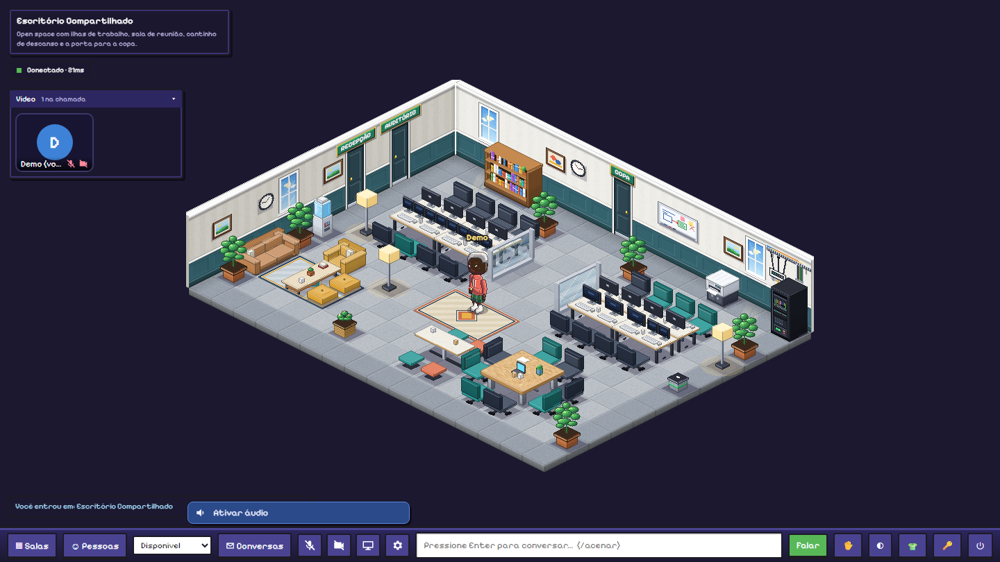
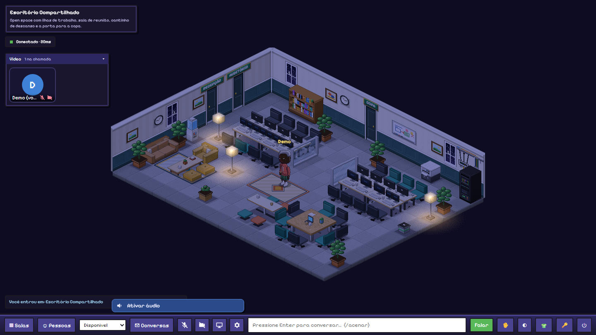
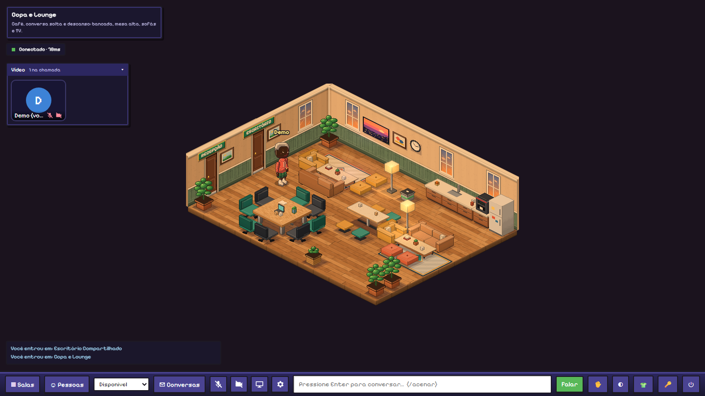
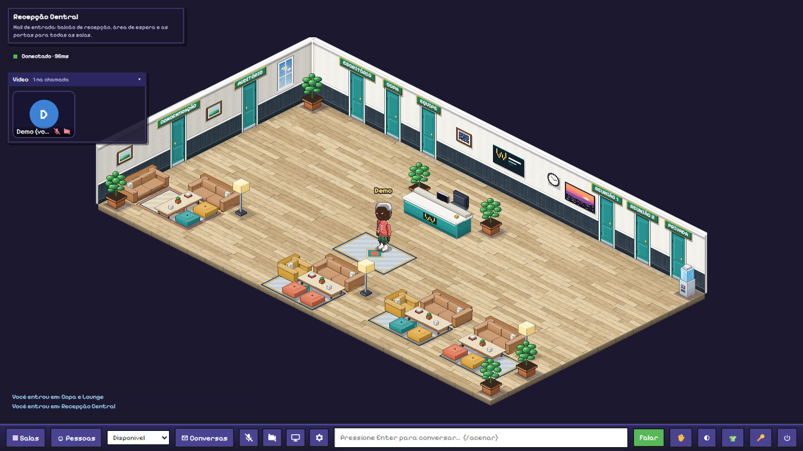
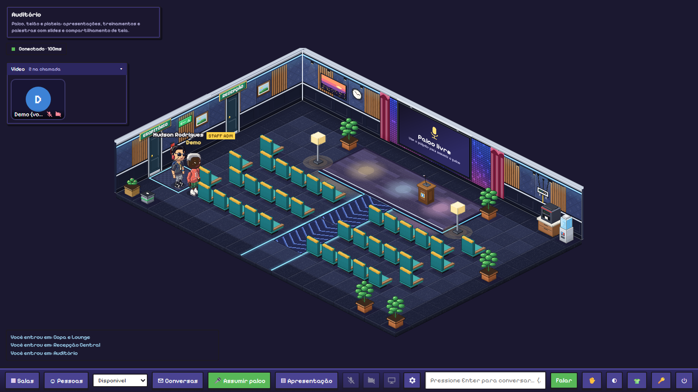
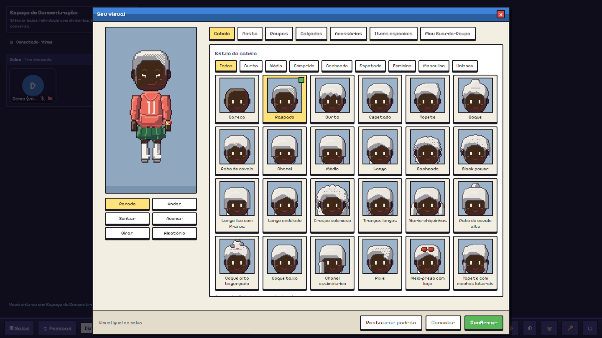
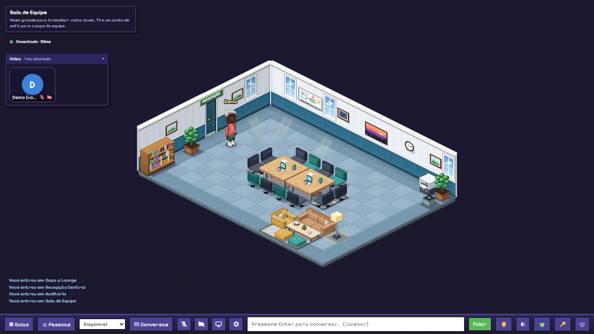
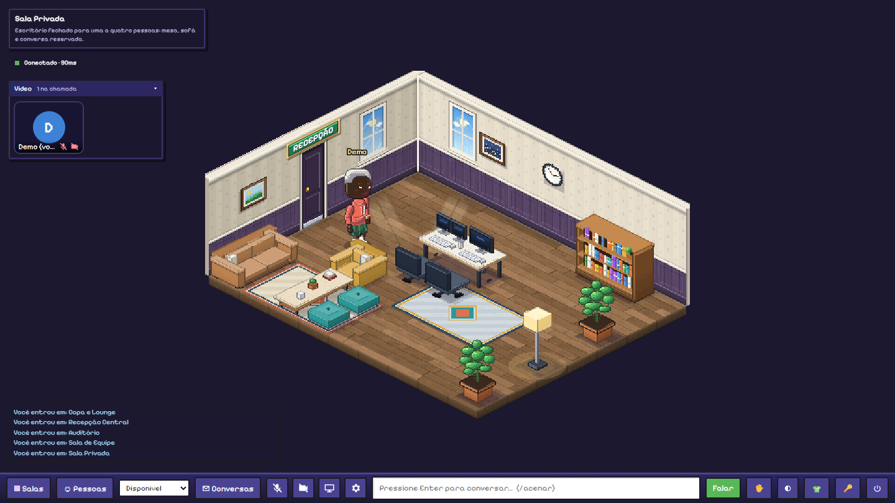
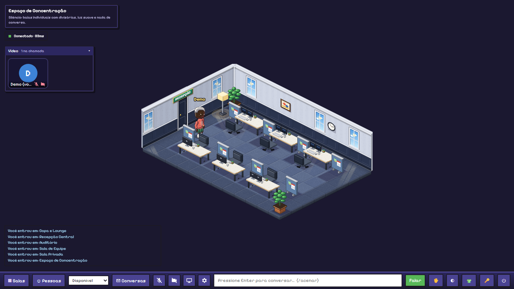
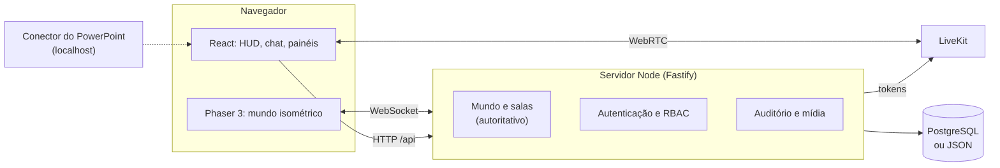

<div align="center">

# WorkVerse

**Um escritório virtual multiplayer em pixel art isométrica.**
Salas, avatares personalizáveis, chat em balões, reuniões com áudio e vídeo, auditório com apresentações e painel de administração, tudo em tempo real no navegador.




</div>

> **English summary.** WorkVerse is a multiplayer virtual office rendered as isometric pixel art, in the spirit of classic
> social worlds. It is a full-stack TypeScript project: an authoritative Node/Fastify WebSocket server, a Phaser 3 +
> React client, LiveKit for audio/video/screen sharing, optional PostgreSQL, and every sprite (tiles, furniture, avatars)
> generated procedurally in code, with no external art assets. The docs below are in Brazilian Portuguese.

---

## Por que existe

A ideia é uma plataforma de trabalho remoto com a familiaridade dos mundos sociais clássicos: em vez de uma grade de
vídeos, as pessoas **andam por salas**, sentam em mesas, encontram colegas na copa, assistem a apresentações no
auditório e conversam por balões, com áudio e vídeo quando precisam. O mundo virtual é a interface; as ferramentas
corporativas ficam integradas a ele.

## Galeria

| | |
|---|---|
|  |  |
| **Ciclo de dia** acompanhando o relógio do computador: luzes acendem, o céu das janelas muda | **Copa e Lounge** com bancada, TV e áreas de conversa |
|  |  |
| **Recepção Central**: hub com 8 portas identificadas por placas | **Auditório** com palco, telão, púlpito e plateia |
|  |  |
| **Editor de avatar** com abas, miniaturas, filtros e guarda-roupa | **Sala de equipe**, e também reunião, privada e concentração |

<details>
<summary>Mais salas</summary>

 

</details>

## O que dá para fazer

**Mundo isométrico**
- 9 salas (recepção, escritório, copa, auditório, equipe, duas de reunião, privada e concentração) ligadas por portas com placas.
- Clique no chão para andar: caminho por A\* validado no servidor, animação por direção e profundidade correta (avatares passam na frente e atrás dos móveis).
- Sentar em cadeiras e sofás; **sentar num computador mostra "trabalhando"**; pegar café ou água e ver a caneca na mão.
- **Ciclo de dia real**: a iluminação e o céu das janelas seguem o horário do seu computador.

**Avatares**
- Aparência em camadas, 4 visões e 13 quadros de animação (parado, andar, sentar, acenar), **91 itens** em 6 categorias e **36 tipos de móvel**, tudo desenhado por código.
- Editor com miniaturas, cores por paleta, filtros, conjuntos de roupa nomeados ("Meu Guarda-Roupa") e estrutura de desbloqueio de itens.

**Comunicação e trabalho**
- Chat em balões, mensagens privadas, chat de equipe, status de presença (disponível, ocupado, concentrado, em reunião, ausente) e notificações.
- Áudio, vídeo e compartilhamento de tela via **LiveKit**, com áudio por proximidade opcional e o chat funcionando mesmo sem permissão de microfone ou câmera.
- **Auditório**: papéis de palestrante e plateia validados no servidor, tela compartilhada em estilo reunião, slides de imagem sincronizados, "levantar a mão" e palco aberto.
- **Controle do PowerPoint dentro do WorkVerse**: um conector local comanda o PowerPoint real (iniciar, avançar, voltar, ir ao slide, notas do orador) sem o apresentador tocar no aplicativo.

**Administração e segurança**
- Cadastro público **fechado**: só a equipe (staff) cria contas.
- Papel de **staff da plataforma** (helper, moderator, admin) com selo dourado verificado pelo servidor e auditoria; organizações com papéis e isolamento no servidor.
- Hash de senha scrypt, cookie `HttpOnly` + `SameSite=Strict`, limites de taxa, validação estrita de todas as mensagens e uma revisão de segurança com testes de ataque ([docs/security.md](docs/security.md)).

## Destaques de engenharia

| Tema | Como foi resolvido |
|---|---|
| **Servidor autoritativo** | O cliente só envia intenções; o servidor valida o destino, calcula o caminho e envia **uma** mensagem por trajeto. Os clientes interpolam, então não há fluxo de posições. |
| **Arte 100% procedural** | Tiles, móveis e personagens são pintados em canvas por código, em pixels nítidos, sem nenhum arquivo de imagem externo. |
| **Ordem de desenho** | Ordenação topológica de caixas 3D por quadro: avatares, móveis e objetos de parede sempre se sobrepõem corretamente. |
| **Dados, não código** | Salas, móveis e itens de avatar são tabelas; adicionar um item é uma entrada de dados mais uma função de desenho. |
| **Desempenho medido** | Teste de carga progressivo até **800 conexões** simultâneas: ping p95 ≤ 3 ms e movimento até o caminho p95 ≤ 5,2 ms, com ~7% de um núcleo em 110 jogadores ativos ([relatório](docs/load-report.md)). |
| **Segurança testada** | Suíte que reproduz ataques (mensagens forjadas, IDOR entre organizações, inundação de conexões, CSRF, upload de SVG) e revisão documentada. |
| **Integração real** | Os testes do conector do PowerPoint abrem o PowerPoint de verdade via COM e conferem o slide pelo próprio aplicativo. |
| **Persistência trocável** | Arquivo JSON por padrão, **PostgreSQL** com migrações versionadas, importador, backup e restauração (testados com Postgres real). |

## Arquitetura



```
packages/shared   geometria isométrica, A*, salas e móveis (dados), catálogo de avatar, protocolo
apps/server       Fastify + WebSocket: mundo, autenticação, staff, auditório, mídia, métricas
apps/client       React (HUD) + Phaser (cena); arte procedural em apps/client/src/game
tools/            conector do PowerPoint e instaladores de LiveKit/Postgres (binários ficam fora do git)
scripts/          desenvolvimento, produção, publicação, backup e restauração
docs/             documentação por tema
```

Mais detalhes em [docs/architecture.md](docs/architecture.md).

## Como rodar

Requisitos: **Node.js 22+** (testado com 24) e npm. Para voz e vídeo locais no Windows: `npm run livekit:setup`.

```bash
npm install
npm run dev            # servidor (3001) + site (5173) [+ LiveKit local, se instalado]
```

No Windows, o atalho é dar dois cliques em **`iniciar.bat`**. Abra <http://localhost:5173>.

O cadastro é fechado, então crie a primeira conta pelo comando abaixo (com o servidor parado) e entre com ela:

```bash
npm run account:create -w @workverse/server -- voce@email.com SeuNome
```

Para testar rápido sem senha, com `ALLOW_DEV_LOGIN=1` (**somente desenvolvimento**), use `http://localhost:5173/?name=Ana`.
Para ser staff admin, crie um arquivo `.env.local` com `BOOTSTRAP_STAFF_EMAILS=voce@email.com:admin`.

```bash
npm test               # 430+ testes (unidade, integração, rede, segurança, PostgreSQL embutido)
npm run typecheck      # tsc em todos os projetos
npm run build          # build do cliente
npm run loadtest       # teste de carga progressivo
```

## Documentação

| Tema | Arquivo |
|---|---|
| Arquitetura | [docs/architecture.md](docs/architecture.md) |
| Configuração e autenticação | [docs/configuration.md](docs/configuration.md) |
| Salas e layouts | [docs/rooms.md](docs/rooms.md) |
| Avatares, itens e guarda-roupa | [docs/avatar-items.md](docs/avatar-items.md) |
| Interações (trabalhar, café, água) | [docs/interactions.md](docs/interactions.md) |
| Chat, DM, equipe e status | [docs/social.md](docs/social.md) |
| Áudio e vídeo (LiveKit) | [docs/media.md](docs/media.md) |
| Auditório e apresentações | [docs/auditorium.md](docs/auditorium.md) |
| Controle do PowerPoint | [docs/powerpoint.md](docs/powerpoint.md) |
| Staff e administração | [docs/staff.md](docs/staff.md) |
| Segurança | [docs/security.md](docs/security.md) |
| Banco de dados, backup e restauração | [docs/database.md](docs/database.md) |
| Monitoramento e métricas | [docs/monitoring.md](docs/monitoring.md) |
| Teste de carga | [docs/load-testing.md](docs/load-testing.md) |
| Colocar online (Cloudflare, VPS, PaaS) | [docs/deploy.md](docs/deploy.md) |

## Estado e limitações

Projeto de portfólio em evolução. O que **ainda não existe** ou tem limite conhecido:

- Sem verificação de e-mail, recuperação de senha por e-mail ou CAPTCHA (as contas são criadas pela equipe).
- A simulação de cada sala roda em **uma instância**; o barramento Redis para presença entre servidores está pronto e testado, mas ainda não ligado ao mundo.
- O controle do PowerPoint funciona só no **Windows** com o PowerPoint instalado.
- Tarefas, calendário e arquivos compartilhados fazem parte do plano, mas ainda não foram implementados.
- Voz e vídeo pela internet exigem um servidor LiveKit acessível (por exemplo, LiveKit Cloud).
- Docker: há `docker-compose.yml` e `Dockerfile`, mas **nunca foram executados** neste ambiente (sem Docker); a rota validada é Node direto.

## Créditos e aviso

- **Arte original.** Todos os sprites são gerados por código. O visual é inspirado na linguagem dos mundos sociais isométricos clássicos, **sem usar sprites, mapas, código ou marca de nenhum deles**. O projeto não tem relação com Habbo, Sulake ou qualquer empresa desse gênero.
- Fontes [Pixelify Sans](https://fonts.google.com/specimen/Pixelify+Sans) e [Silkscreen](https://fonts.google.com/specimen/Silkscreen) (SIL Open Font License), carregadas do Google Fonts.
- Bibliotecas: [Phaser](https://phaser.io), [React](https://react.dev), [Fastify](https://fastify.dev) e [LiveKit](https://livekit.io) (Apache-2.0), entre outras, cada uma sob sua licença.

## Licença

[MIT](LICENSE) © 2026 Hudson Santos Rodrigues
