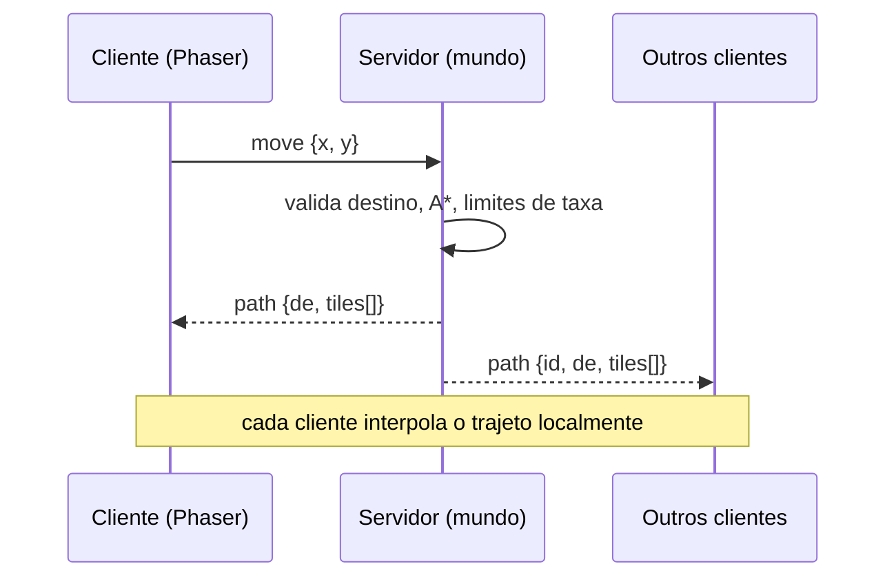

# Arquitetura

```
packages/shared   lógica pura usada por cliente e servidor: geometria isométrica, A*, catálogo de móveis,
                  definição das salas (dados), catálogo de avatar e protocolo
apps/server       Fastify + @fastify/websocket; mundo autoritativo (salas, jogadores, validação),
                  autenticação, staff, auditório, mídia e métricas
apps/client       React (HUD) + Phaser 3 (render); arte procedural em canvas
tools/            conector do PowerPoint e instaladores de LiveKit/PostgreSQL
```

## Decisões principais

- **Servidor autoritativo.** O cliente só envia intenções (`move`, `interact`, `chat`...). O servidor valida o alvo,
  calcula o caminho com A\* de 8 direções (sem cortar quinas) e envia **uma única mensagem de caminho**; todos os
  clientes interpolam localmente (380 ms por tile). Não há fluxo de posições.
- **Troca de rota no meio do passo.** O servidor considera o avatar já "entrando" no tile seguinte, então o novo
  caminho parte dali e não há teleporte.
- **Profundidade.** O cliente ordena sprites por ordenação topológica de caixas 3D por quadro: avatares passam à
  frente e atrás de mesas, cadeiras com encosto próximo ao observador, objetos de parede etc.
- **Arte procedural.** Tiles, móveis e avatares são pintados em canvas por código, em pixels nítidos; um avatar é
  composto por camadas (corpo, rosto, cabelo, roupas, calçados, acessórios, itens de mão) e recolorido por paleta,
  sem filtros que borrem os pixels.
- **Dados, não código.** Salas, móveis e itens de avatar são tabelas em `packages/shared`. Um novo móvel é uma entrada
  em `FURNI_KINDS` mais um construtor em `furniture.ts`; um novo item de avatar é uma entrada no catálogo mais uma
  função de desenho. O motor e o protocolo não mudam.
- **Regras de layout testadas.** Um teste falha se um sofá olhar para a parede ou para o vazio, se uma estante não
  estiver encostada na parede, ou se algum assento ou objeto usável ficar inalcançável.
- **Reconexão.** O cliente reconecta com backoff exponencial, reenvia o `hello` (a identidade vem do cookie) e volta à
  última sala; há indicador de conexão e latência no HUD.
- **Persistência trocável.** `AccountStore` é uma interface síncrona com cache em memória e escrita assíncrona
  (write-behind): implementações em memória, arquivo JSON e PostgreSQL com migrações versionadas.
- **Abuso.** Limite de tamanho por mensagem, *token bucket* por conexão e por ação, sanitização de texto (controle,
  zero-width e overrides bidi), desconexão após mensagens inválidas repetidas, *heartbeat* de 20 s.

## Fluxo de dados


